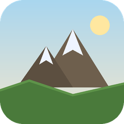

# LiteTerrain



Procedural chunked terrain for Godot 4, built for mobile. Add one **`ChunkTerrain`** node and the world
builds itself from a seed: no heightmap file, no world-sized array, no edge. LOD merges chunks instead of
decimating them, collision is cut only under the bodies that need it, and five biomes — desert, meadow,
salt flats, canyon, mountains — come from a single resource that drives the landform and the colours together.

Built and tuned on an Adreno 610 (a low-end mobile GPU), so every default leans toward performance.

> **2.0 is a new design, not an update of 1.x.** The 1.x line was one node script over a baked height map,
> with a dock for sculpting, generating and baking. 2.0 has no height map: the ground *is* the seed. See
> [Coming from 1.x](#coming-from-1x).

## It is an architecture, not a script

```
ChunkTerrain ──asks for heights──► LiteTerrainGen ◄──masks── TerrainBiomes ──colours──► glsl.gdshader
 the node: LOD tree, queues,       height_at(x, z): noise,     one Resource: masks,       biome colour, slope rock,
 thread pool, collision tiles,     blur and canyon cut at      noise and the colours      grass lift, detail, haze
 edits, occlusion                  ONE world point             handed to the shader
```

- **The generator answers by point and nothing else** — it touches no scene and no file, so it runs on worker
  threads and the same seed is the same world in the editor, in the game and on a phone.
- **The node owns time and memory** — what exists this tick, what is drawn, what is computed next, what is kept
  and which collision tiles are cut.
- **The biomes are data** — one resource, baked into vertex colour, so the shader never recomputes a mask.
- **The shader only reads.**

## Features

- **A world from a seed** — `forced_seed` in the inspector; the same seed gives the same ground everywhere.
  The ground has no edge, memory equals what is on screen, a distant chunk costs nothing.
- **LOD by merging chunks** — a node of level L covers 2^L × 2^L chunks and is drawn with the same 16×16 quads;
  seams are closed by pulling the finer edge onto the coarser one (no skirts), and a level change goes up as one
  unit, so no crack shows while you drive. Sub-pixel ground is never split.
- **Threaded, budgeted** — the pool computes chunks in batches; the main thread lands a few meshes a frame, so
  new ground costs no hitches.
- **Streaming collision** — tiles are cut under every `RigidBody3D` / `CharacterBody3D`, along its path a moment
  ahead, on their own queue that goes first.
- **Five biomes in one resource** — landform, masks and colours agree by construction. Switch any biome off from
  the node.
- **A painted ground shader** — slope rock, snow crust, grass lift and per-biome detail from one texture fetch,
  with distance haze. An optional self-lit `fast_ground` mode skips the engine's light loop on weak GPUs.
- **Runtime API** — heights and slope at a point, biome masks, flatten a pad (edits are a saveable list),
  "is it behind a hill?" for culling your own props.
- **Editor preview** — a **Build in scene** button at the top of the node's inspector builds the real ground
  round the editor camera.

## Installation

### From the Asset Store
Search for **LiteTerrain**, install, then enable it in **Project > Project Settings > Plugins**.

### Manually
1. Copy `addons/lite_terrain/` into your project's `addons/` directory.
2. Enable **LiteTerrain** in **Project > Project Settings > Plugins**. Enabling it also declares the global
   shader uniforms the ground shader reads (without the haze pair it would not compile); restart the editor
   once after enabling it for the first time so Godot picks them up.

## Quick start

1. Add a **ChunkTerrain** node to a 3D scene, and set `forced_seed`.
2. Press **Build in scene** at the top of its inspector to see the ground in the editor.
3. Make sure the scene has a current `Camera3D` and a `DirectionalLight3D`, and run it.

Full documentation — the node and its settings, biomes, the runtime API, editing the ground, collision, shader
globals, how it works and troubleshooting — is in [`addons/lite_terrain/README.md`](addons/lite_terrain/README.md).

## Coming from 1.x

2.0 does not read 1.x data and has no migration path, by design: there is no height map left to convert.
Removed: the `LiteTerrain` node and `map.gd`, the sculpt brush, the generate / bake / PNG buttons, image mode,
`terrain_mesh.res` / `terrain_height.res`, and the `Dark/` tile textures. The node is now `ChunkTerrain`; a
scene that used the old node has to be rebuilt around it.

## Compatibility

Godot 4.6 / 4.7. Developed and measured on the Compatibility (GLES3) renderer; collision tested with both Godot Physics and Jolt.

## License

[MIT](LICENSE) © MrKrob00
